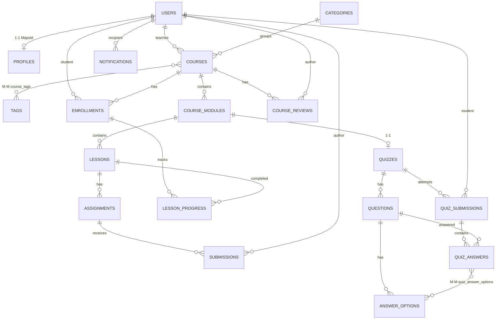
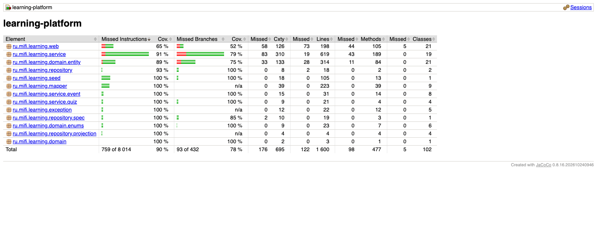

# Учебная платформа

REST-приложение для обучения на курсах. Преподаватель публикует уроки, задания и тесты. Студент записывается на курс, сдаёт работы и видит свой прогресс. Стек — Java 21, Spring Boot 3.5.16, Spring Data JPA, Hibernate 6.6 и PostgreSQL 17.

## Запуск в Docker

Из корня проекта выполните две команды. Потребуются Docker и Docker Compose.

```sh
cp -n .env.example .env
docker compose --profile tools up --build -d --wait
```

Compose соберёт приложение на Java 21 и поднимет PostgreSQL 17. Профиль `tools` также запустит Adminer. При следующих запусках достаточно второй команды.

- [Swagger UI](http://localhost:8080/swagger-ui.html) — документация и вызов API.
- [Готовность приложения](http://localhost:8080/actuator/health/readiness) — возвращает `200 UP` после запуска и завершения начального заполнения, если PostgreSQL доступна. Этот адрес использует Docker Compose.
- [Adminer](http://localhost:8081) — выберите PostgreSQL, сервер `db`, базу и учётные данные из `.env`.

Для остановки выполните `docker compose --profile tools down`. Данные PostgreSQL сохраняются в томе `pgdata`.

### Запуск для разработки

Для двух вариантов ниже нужны JDK 21 и работающий Docker. Обёртка `mvnw` скачает нужную версию Maven. Запускайте один вариант приложения за раз. По умолчанию каждый слушает порт 8080.

**Приложение на хосте, PostgreSQL в Compose.** В корне проекта выполните команды. При переходе с полного стека сначала остановите его командой из предыдущего раздела.

```sh
cp -n .env.example .env
docker compose up -d --wait db
./mvnw spring-boot:run
```

**Приложение на хосте, временная PostgreSQL в Testcontainers.** Контейнер создаётся с отдельной базой и свободным портом. Остановка приложения через Ctrl+C завершает и этот контейнер.

```sh
./mvnw spring-boot:test-run
```

### Профили и настройки

| Профиль Spring | Использование | Схема и данные |
|---|---|---|
| `dev` (по умолчанию) | Локальный запуск, в том числе `spring-boot:test-run` | Hibernate обновляет схему. Приложение создаёт демо-каталог при первом запуске на пустой базе. В журнале доступны SQL и параметры. |
| `test` | Автоматические интеграционные тесты | Отдельный PostgreSQL, `create-drop`, статистика Hibernate. Демо-набор включают только тесты заполнения. |
| `prod` | Контейнер приложения в Compose | Hibernate обновляет схему в томе PostgreSQL. Заполнением управляет `APP_SEED_ENABLED`. |

| Переменная | Назначение |
|---|---|
| `POSTGRES_DB`, `POSTGRES_USER`, `POSTGRES_PASSWORD` | База и учётные данные для инициализации тома PostgreSQL. Compose передаёт соответствующие значения приложению. |
| `DB_URL`, `DB_USERNAME`, `DB_PASSWORD` | JDBC-подключение с хоста. При изменении параметров PostgreSQL обновите эти значения в `.env`. В Compose JDBC-адрес указывает на сервис `db`. |
| `SPRING_PROFILES_ACTIVE` | Выбор профиля. В Compose уже задан `prod`. |
| `APP_SEED_ENABLED` | В профилях `dev` и `prod` по умолчанию `true`. Укажите `false` в `.env`, чтобы пропустить создание демо-данных. |
| `SERVER_PORT` | Порт локального Spring Boot приложения, по умолчанию 8080. |

Шаблон конфигурации — [.env.example](.env.example). Для Testcontainers параметры соединения предоставляет `@ServiceConnection`.

## Учебный сценарий в Swagger UI

1. Создайте категорию и двух пользователей с ролями `TEACHER` и `STUDENT`.
2. Создайте курс с модулем и уроком, укажите преподавателя и опубликуйте курс.
3. Добавьте задание к уроку и тест к модулю. Запишите студента на курс.
4. Отправьте решение от имени студента и выставьте оценку. Для прохождения теста возьмите идентификаторы вопросов и вариантов из студенческого представления.
5. Отметьте урок пройденным и сдайте тест. Статус записи и прогресс доступны в `GET /api/courses/{id}/progress/{studentId}`.

## Демо-данные

При первом запуске на пустой базе приложение создаёт четыре курса и восемь пользователей с профилями. Если в базе уже есть хотя бы один пользователь, заполнение пропускается. Чтобы запустить пустую учебную базу, укажите `APP_SEED_ENABLED=false` в `.env` до первого запуска.

| ID на новом томе | Пользователь | Email | Роль |
|---|---|---|---|
| 1 | Ольга Соколова | admin@example.com | ADMIN |
| 2 | Анна Миронова | anna@example.com | TEACHER |
| 3 | Павел Орлов | pavel@example.com | TEACHER |
| 4 | Ирина Волкова | irina@example.com | STUDENT |
| 5 | Максим Власов | maxim@example.com | STUDENT |
| 6 | Вера Белова | vera@example.com | STUDENT |
| 7 | Олег Зайцев | oleg@example.com | STUDENT |
| 8 | Софья Лебедева | sofia@example.com | STUDENT |

| ID на новом томе | Курс | Статус |
|---|---|---|
| 1 | Основы Hibernate | PUBLISHED |
| 2 | Spring Boot для начинающих | PUBLISHED |
| 3 | PostgreSQL на практике | PUBLISHED |
| 4 | Docker и CI | DRAFT |

В курсе «Основы Hibernate» Ирина прошла четыре урока и оба теста. Максим отметил все уроки, но провалил тест и продолжает обучение. Вера прошла один урок. Сравните их результаты в Swagger через `GET /api/courses/{id}/progress/{studentId}`. Поле `percent` показывает долю пройденных уроков. Для завершения курса нужны все уроки и хотя бы одна успешная попытка по каждому тесту с вопросами. Пустая викторина становится обязательной при добавлении первого вопроса. Поэтому у Максима одновременно `percent=100` и `status=ACTIVE`. В существующей базе фактические ID можно узнать через `GET /api/users` и `GET /api/courses`.

В [http/demo.http](http/demo.http) есть пошаговый сценарий для IntelliJ HTTP Client и VS Code REST Client. Он использует демо-преподавателя и студента. При каждом прохождении создаётся отдельный курс. Запускайте запросы по порядку и подставляйте идентификаторы из ответов в переменные в начале файла.

## Уведомления

Студент получает уведомление при записи на курс, выставлении оценки и завершении курса. О новом задании узнают все активные студенты курса. Учебная имитация отправки email пишет в журнал приложения после коммита транзакции.

| Запрос | Результат |
|---|---|
| `GET /api/users/{id}/notifications?unreadOnly=true&page=0&size=10` | Страница непрочитанных уведомлений, сначала новые |
| `PATCH /api/notifications/{id}/read` | Прочитанное уведомление |
| `POST /api/users/{id}/notifications/read-all` | Число записей, отмеченных прочитанными |

## REST API

В API 84 операции. В таблице пути указаны относительно `/api/`. Схемы DTO, параметры фильтрации, сортировку и примеры запросов можно посмотреть и выполнить в [Swagger UI](http://localhost:8080/swagger-ui.html). Машиночитаемое описание доступно в [OpenAPI JSON](http://localhost:8080/v3/api-docs).

| Группа | Методы и пути |
|---|---|
| Пользователи | `GET/POST users`<br>`GET/PUT/DELETE users/{id}` |
| Профили | `GET/PUT users/{id}/profile` |
| Категории | `GET/POST categories`<br>`GET/PUT/DELETE categories/{id}` |
| Теги | `GET/POST tags`<br>`GET/DELETE tags/{id}` |
| Курсы | `GET/POST courses`<br>`GET/PUT/DELETE courses/{id}`<br>`PUT courses/{id}/tags`<br>`POST courses/{id}/archive`<br>`POST courses/{id}/publish`<br>`GET courses/{id}/structure` |
| Модули | `GET/PUT/DELETE modules/{id}`<br>`GET/POST courses/{id}/modules` |
| Уроки | `GET/PUT/DELETE lessons/{id}`<br>`GET/POST modules/{id}/lessons` |
| Запись на курс | `GET/POST courses/{id}/enrollments`<br>`GET/DELETE courses/{id}/enrollments/{studentId}` |
| Курсы пользователя | `GET users/{id}/courses`<br>`GET users/{id}/courses-taught` |
| Прогресс | `POST lessons/{id}/completions`<br>`GET lessons/{id}/completions/{studentId}`<br>`GET courses/{id}/progress/{studentId}` |
| Отзывы | `GET/PUT/DELETE reviews/{id}`<br>`GET/POST courses/{id}/reviews` |
| Задания | `GET/PUT/DELETE assignments/{id}`<br>`GET/POST lessons/{id}/assignments` |
| Задания студента | `GET users/{id}/assignments` |
| Решения | `GET/DELETE submissions/{id}`<br>`PUT submissions/{id}/grade`<br>`GET users/{id}/submissions`<br>`GET/POST assignments/{id}/submissions` |
| Учебные тесты | `GET/PUT/DELETE quizzes/{id}`<br>`GET/PUT/DELETE questions/{id}`<br>`GET/POST modules/{id}/quiz`<br>`GET quizzes/{id}/full`<br>`POST quizzes/{id}/questions` |
| Попытки тестирования | `GET/DELETE quiz-submissions/{id}`<br>`GET/POST quizzes/{id}/submissions` |
| Результаты студента | `GET users/{id}/quiz-submissions` |
| Уведомления | `PATCH notifications/{id}/read`<br>`GET users/{id}/notifications`<br>`POST users/{id}/notifications/read-all` |
| Аналитика | `GET analytics/courses/{id}`<br>`GET analytics/quizzes/{id}`<br>`GET analytics/students/{id}`<br>`GET analytics/courses/top-rated`<br>`GET analytics/courses/{id}/leaderboard` |

После создания ресурса сервер возвращает `201`. По адресу из заголовка `Location` можно получить ресурс методом `GET`. Для отметки урока этот адрес включает идентификаторы урока и студента. Первый `PUT users/{id}/profile` и первая отметка урока возвращают `201`, при повторном запросе — `200`. Удаление возвращает `204`. Для постраничных списков ответ содержит `content`, `page`, `size`, `totalElements` и `totalPages`. Нумерация страниц начинается с нуля. Курсы можно сортировать, например, по названию (`sort=title,asc`) или имени преподавателя (`sort=teacher.fullName,asc`). Сортировка по коллекции (`sort=tags.name`) возвращает `400 INVALID_SORT`: у одного курса может быть несколько тегов.

При повторном сохранении вопроса варианты с прежним текстом и признаком правильности сохраняют свои ID, в том числе при перестановке. Студент может отправить ранее выбранный ответ. Если два варианта после удаления крайних пробелов имеют одинаковый текст и разные признаки правильности, API отклоняет вопрос с `422 INVALID_QUESTION`.

Для зачёта теста учитывается точная доля набранных баллов. Поле `percent` округляется до ближайшего целого для отображения. Например, при пороге 100% результат 199 из 200 даёт `percent=100` и `passed=false`.

Поле профиля `birthDate` принимает сегодняшнюю или более раннюю дату. Дата в будущем возвращает `400 VALIDATION_FAILED`.

Имена тегов хранятся в нижнем регистре. После удаления пробелов по краям и приведения к нижнему регистру имя должно содержать от 1 до 50 символов Unicode.

Передавайте идентификаторы в JSON целыми числами, а значения перечислений — именами, например `"STUDENT"`. Дробный идентификатор и числовой код роли дают `400 MALFORMED_REQUEST`. Для поля `correct` используйте JSON-значения `true` и `false`, для текстовых полей — строки. Строка вместо целого числа, число вместо логического значения и число или логическое значение вместо текста дают `400 MALFORMED_REQUEST`.

Для оценки используйте целое число в поле `score`. При максимуме 10 запрос с `{"score":10}` сохраняет оценку, `{"score":11}` возвращает `422 SCORE_OUT_OF_RANGE`, а `{"score":10.9}` — `400 MALFORMED_REQUEST`. В двух последних случаях решение сохраняет прежние оценку и статус. Повтор того же запроса с прежним баллом и комментарием сохраняет время проверки. Новое уведомление студент получает при изменении балла или комментария.

При создании и обновлении отзыва поле `rating` принимает целое JSON-число от 1 до 5 включительно. Дробное число или строка дают `400 MALFORMED_REQUEST`, целое число вне диапазона — `400 VALIDATION_FAILED`.

Преподаватель и администратор могут вести курс. При переходе между этими ролями пользователь сохраняет свои курсы. Для перевода владельца курса в студенты сначала передайте курс другому преподавателю или администратору.

Роль зачисленного студента можно изменить после отписки от всех курсов. При редактировании задания максимальный балл должен быть не ниже наибольшей выставленной оценки. В обоих случаях конфликт с сохранёнными данными возвращает `409`.

| HTTP | Пример кода ошибки | Когда возникает |
|---|---|---|
| 400 | `VALIDATION_FAILED`, `MALFORMED_REQUEST`, `INVALID_SORT` | Поле не прошло проверку, JSON не соответствует типам полей или выбранное поле сортировки недопустимо |
| 400 | `INVALID_PAGE_PARAMETER` | Переданы некорректные `page` или `size`. Номер страницы начинается с 0, размер — с 1. При отсутствии параметров применяются значения по умолчанию. |
| 400 | `INVALID_PAGE_OFFSET` | Смещение страницы (`page × size`) больше 2 147 483 647 |
| 404 | `USER_NOT_FOUND`, `COURSE_NOT_FOUND` | Ресурс с переданным ID отсутствует |
| 404 | `ENROLLMENT_NOT_FOUND` | Запись для указанной пары студента и курса отсутствует. Сообщение содержит оба идентификатора |
| 409 | `COURSE_REQUIRES_LESSON` | Удаление урока или модуля оставило бы опубликованный курс или курс с активными студентами без уроков |
| 409 | `ALREADY_ENROLLED`, `COURSE_HAS_LEARNING_DATA` | Повторная запись или попытка удалить курс с учебной историей |
| 409 | `ORDER_INDEX_EXHAUSTED` | Последняя позиция модуля или урока равна 2 147 483 647. Можно явно указать свободную позицию |
| 422 | `COURSE_EMPTY` | Для публикации и новой записи в курс требуется хотя бы один урок |
| 422 | `COURSE_NOT_OPEN`, `SCORE_OUT_OF_RANGE` | Запрос нарушает предметное правило |
| 422 | `INVALID_QUESTION` | Некорректные варианты ответа или сумма баллов за вопросы превышает 2 147 483 647 |
| 500 | `INTERNAL_ERROR` | Непредвиденная ошибка. Подробности сохраняются в журнале приложения |

Пример `application/problem+json` при запросе отсутствующего пользователя.

```json
{
  "type": "about:blank",
  "title": "Not Found",
  "status": 404,
  "detail": "Объект User с идентификатором 999999999 не найден",
  "instance": "/api/users/999999999",
  "code": "USER_NOT_FOUND"
}
```

### Как читать аналитику

В отчёте студента лучший процент за тест берётся по всем попыткам курса. В лидерборде к баллам за проверенные задания прибавляются лучшие баллы за каждый отдельный тест. Равные суммы дают одинаковое место. Доля успешных попыток считается по всем попыткам, включая повторные. Пока оценок или попыток нет, соответствующее среднее равно `null`.

## Архитектура

```text
HTTP → web → service → repository → PostgreSQL
        DTO     │          ↑
                ├── domain/entity
                ├── mapper → DTO ответа
                └── service/event → уведомление
```

Контроллеры принимают DTO, выполняют Bean Validation и формируют HTTP-ответ. Сервис открывает транзакцию, проверяет бизнес-правила и собирает DTO через маппер. Сущности остаются внутри транзакции, Open Session in View отключён. Для чтения сервисы используют транзакции `readOnly`, для изменения — обычные. Поля версии защищают от потери изменений при параллельной записи.

В `repository` сосредоточены JPQL-запросы, графы сущностей, проекции и спецификации поиска. Для рейтинга студентов PostgreSQL присваивает места оконной функцией `rank()`. Доменное событие сохраняет уведомление в транзакции исходного действия, а обработчик после коммита пишет сообщение о демо-email в журнал. Начальные данные создаёт пакет `seed`. [Исходный код приложения](src/main/java/ru/mifi/learning).

## Модель данных

18 JPA-сущностей хранятся в 20 таблицах. На диаграмме показаны таблицы сущностей. Две связи многие-ко-многим используют промежуточные таблицы `course_tags` и `quiz_answer_options`.



Профиль использует ключ пользователя (`@MapsId`). У модуля может быть один тест. Запись на курс связывает студента с курсом и хранит статус. Составной ключ прогресса `(enrollment_id, lesson_id)` гарантирует одну отметку на урок в пределах записи.

После удаления урока, модуля, теста или последнего вопроса викторины сервис в той же транзакции проверяет активные записи курса. Например, если студент прошёл первый из двух уроков курса без тестов, удаление второго сразу завершит его обучение и создаст одно уведомление. Уже присвоенный статус `COMPLETED` сохраняется при дальнейших изменениях программы. Счётчики уроков и сданных тестов показывают текущее состояние.

Каскады удаляют дочерний контент вместе с родителем. Попытки защищают структуру теста от изменений, а курс с учебной историей можно архивировать. При отписке удаляются запись и отметки уроков, решения, отзывы и попытки остаются. Удаление тега снимает связи с курсами. Подробности видны в [модели](src/main/java/ru/mifi/learning/domain/entity) и [тестах схемы PostgreSQL](src/test/java/ru/mifi/learning/repository/SchemaIT.java).

## Ленивая загрузка в Hibernate

В `LazyLoadingLabIT` девять экспериментов с отдельными транзакциями. Запуск с доступным Docker — `./mvnw -Dtest=LazyLoadingLabIT test`.

| Опыт | Что проверить |
|---|---|
| L1–L3 | После закрытия сессии прокси знает свой ID, а чтение имени или коллекции требует загрузки. Fetch join, граф сущностей и сборка DTO в сервисе задают границу чтения. |
| L4 | Десять курсов с разными преподавателями дают 11 запросов. Граф сущностей сокращает их число до одного. |
| L5 | Одновременный fetch join модулей и уроков вызывает `MultipleBagFetchException`. Два запроса собирают дерево в одном контексте. |
| L6–L7 | Пагинация с fetch join коллекции запрещена настройкой Hibernate. Страница загружает связи to-one графом, а теги читаются пакетами. Для 25 коллекций нужны два дополнительных запроса. |
| L8–L9 | В транзакции чтения изменение названия курса не записывается. Получение ссылки по ID через `getReferenceById` обходится без SELECT. |

## Тестирование и покрытие

Для запуска проверок нужны JDK 21 и Docker. Testcontainers поднимет PostgreSQL для тестов. Из корня проекта выполните команду.

```sh
./mvnw -B clean verify
```

| Уровень | Что проверяет | Тестов |
|---|---|---:|
| Модульные | Доменные правила, подсчёт баллов и сервис с Mockito | 17 |
| Spring MVC | Bean Validation, JSON, коды ответа и обработку ошибок через MockMvc | 19 |
| Интеграционные с PostgreSQL | Схему, CRUD, транзакции, события, аналитику, число SQL-запросов и одновременную запись тегов | 111 |
| Сквозные HTTP с PostgreSQL | Прохождение курса, профиль и дату рождения, чтение по Location, валидацию JSON-типов, рейтинга и тегов, сортировку, параметры и границы пагинации, отсутствующую запись | 12 |
| **Всего** | **Успешно в чистой сборке** | **159** |

JaCoCo проверяет покрытие **строк** для проекта в целом. В проверяемый код вошли сервисы, модель, репозитории, мапперы, обработка ошибок и контроллеры. Из отчёта и порога исключены пакеты `config`, `dto` и точка входа `*Application`. Покрыто **1478 из 1600 строк (92,38%)** при минимуме **70%**. На снимке число пропущенных строк находится в паре столбцов `Missed / Lines`.



HTML-отчёт открывается локально из `target/site/jacoco/index.html`. Отчёты JUnit находятся в `target/surefire-reports/`. При push и pull request GitHub Actions запускает `./mvnw -B verify`: выполняет тесты, проверяет покрытие и формат Java-кода. Отчёты Surefire и JaCoCo доступны в артефакте `test-reports`. После успешной проверки отдельное задание собирает Docker-образ. [Конфигурация GitHub Actions](.github/workflows/ci.yml).

## Ограничения и план развития

Клиент передаёт идентификаторы участников (`studentId`, `teacherId`). Сервис проверяет роль и факт записи там, где этого требует действие. Личность отправителя HTTP-запроса приложение не удостоверяет, поэтому учебный API предназначен для локальной работы.

| Шаг | Что добавить | Почему выделено в отдельный этап |
|---|---|---|
| 1 | Явный контекст действующего пользователя и проверки владельца курса, задания или решения | Сейчас сценарии показывают предметные правила. Учебный заголовок `X-User-Id` позволил бы отдельно проверить правила владения. |
| 2 | Spring Security и JWT | Подтверждение личности и выдача токенов требуют отдельной модели доступа. |
| 3 | Миграции Flyway и `ddl-auto=validate` | Для демонстрации ORM схема создаётся непосредственно из JPA-аннотаций. |
| 4 | Реальная почта и outbox для доставки с повторами | Сейчас отправку после коммита можно наблюдать в журнале, для доставки нужен почтовый сервер. |
| 5 | Файлы решений в S3 или MinIO | В текущей модели студент отправляет текст или ссылку. |
| 6 | Кэш справочников и полнотекстовый поиск курсов | Выбор индексов и кэша требует измерений на характерной нагрузке. |
| 7 | Редактирование решения до проверки и история версий | Текущий сценарий хранит одну сдачу студента на задание. |

## Соответствие критериям

| Критерий | Что проверить | Где смотреть |
|---|---|---|
| 1. Модель данных | 18 сущностей, все три типа связей, составной ключ | [Сущности](src/main/java/ru/mifi/learning/domain/entity) |
| 2. Репозитории и CRUD | Spring Data, уникальные ключи и ограничения | [Репозитории](src/main/java/ru/mifi/learning/repository) |
| 3. Управление контентом | Публикация, карточка и структура курса | [CourseServiceIT](src/test/java/ru/mifi/learning/service/CourseServiceIT.java) |
| 4. Запись на курс | Повторная запись, отписка, списки участников | [EnrollmentServiceIT](src/test/java/ru/mifi/learning/service/EnrollmentServiceIT.java) |
| 5. Задания и решения | Срок сдачи, оценка, диапазон баллов | [SubmissionServiceIT](src/test/java/ru/mifi/learning/service/SubmissionServiceIT.java) |
| 6. Тесты и викторины | Выбор ответов, веса, порог прохождения | [QuizScorerTest](src/test/java/ru/mifi/learning/service/quiz/QuizScorerTest.java) |
| 7. Конфигурация PostgreSQL | Параметры подключения и профили | [Конфигурация Spring](src/main/resources) |
| 8. Интеграционные проверки CRUD | Реальная PostgreSQL, каскады и ограничения | [Тесты репозиториев](src/test/java/ru/mifi/learning/repository) |
| 9. REST API | Полный учебный сценарий, коды HTTP и Location | [HappyPathE2EIT](src/test/java/ru/mifi/learning/web/HappyPathE2EIT.java) |
| 10. Валидация и ошибки | Ошибки запроса и предметные конфликты в ProblemDetail | [GlobalExceptionHandler](src/main/java/ru/mifi/learning/web/GlobalExceptionHandler.java) |
| 11. Демо-данные | Начальное заполнение и повторный запуск | [DemoDataSeederIT](src/test/java/ru/mifi/learning/seed/DemoDataSeederIT.java) |
| 12. Тестирование | JUnit, Surefire и порог покрытия строк | [Сборка Maven](pom.xml) |
| 13. Архитектура и качество | DTO, транзакции сервисов и проверяемые планы загрузки | [LazyLoadingLabIT](src/test/java/ru/mifi/learning/repository/LazyLoadingLabIT.java) |
| 14. Документация | Быстрый старт, ER-диаграмма и исполняемые примеры HTTP | [Демонстрационный сценарий](http/demo.http) |
| 15. DevOps | Compose, сборка и тесты Maven, сборка Docker-образа | [GitHub Actions](.github/workflows/ci.yml) |
